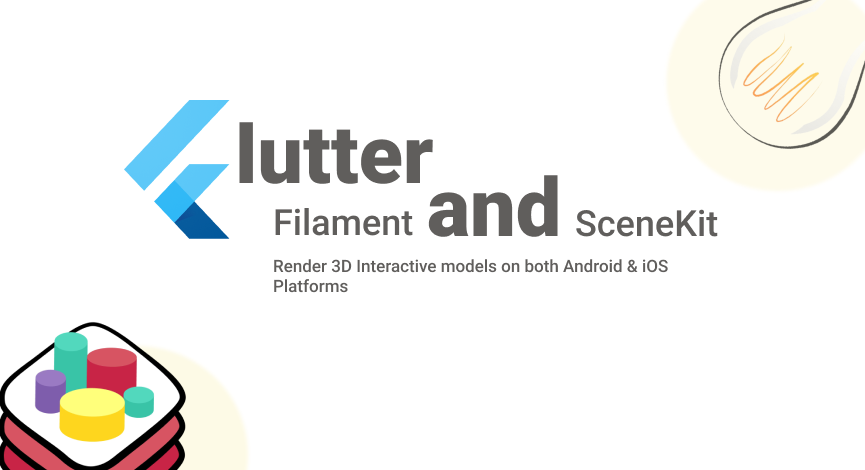
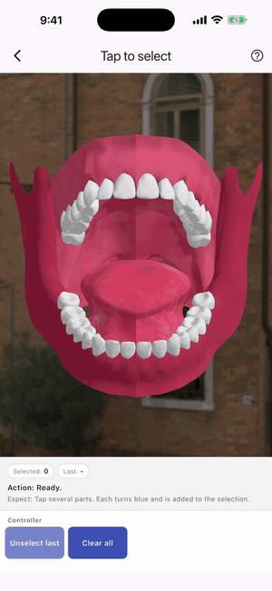
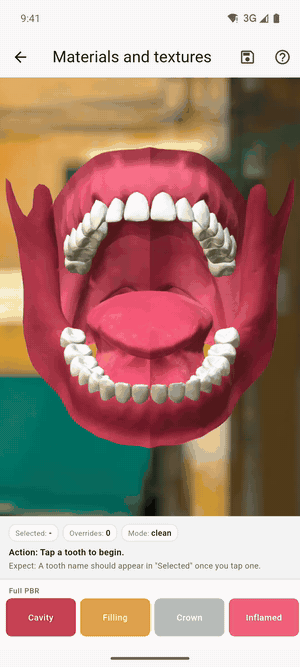
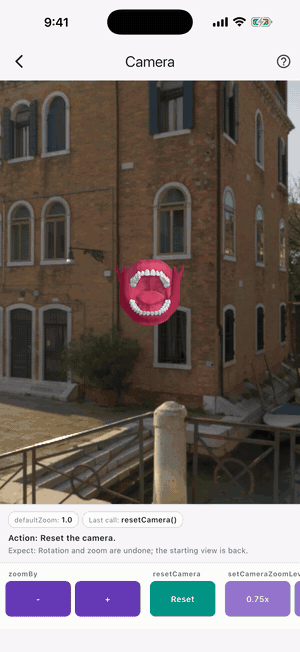
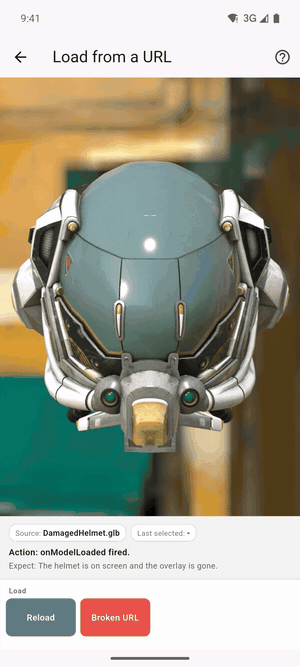
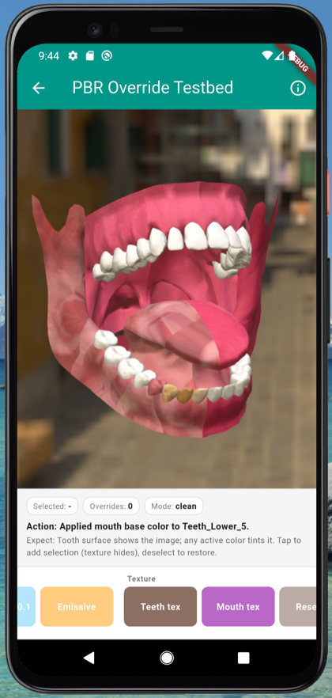
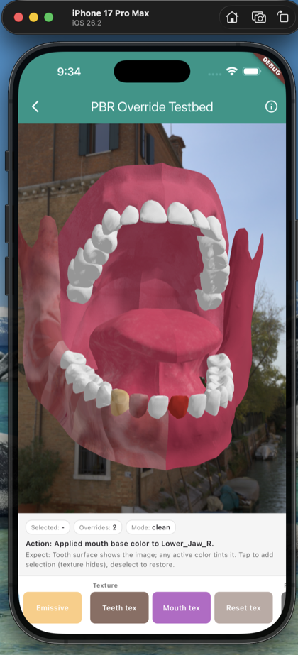
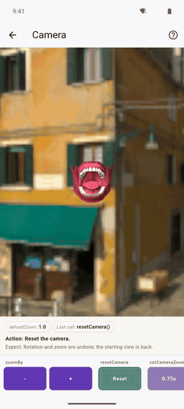
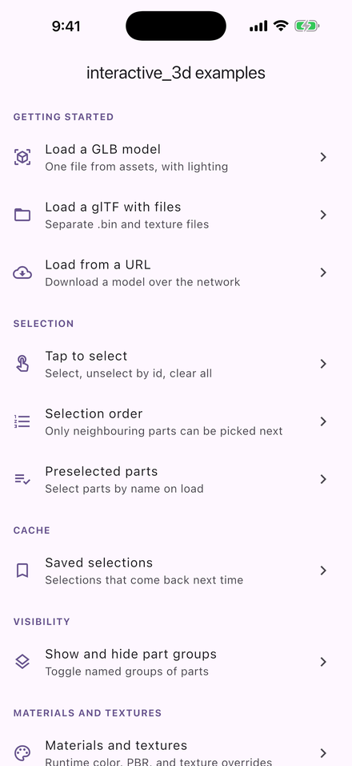

# interactive_3d [](https://pub.dev/packages/interactive_3d)

<p align="center">
  
</p>

<p align="center">
  <a href="https://pub.dev/packages/interactive_3d/score"></a>
  <a href="https://pub.dev/packages/interactive_3d/score"></a>
  <a href="https://opensource.org/licenses/MIT"></a>
  
</p>

<p align="center">
  A Flutter plugin for rendering and interacting with 3D models (<code>.glb</code> / <code>.gltf</code>),
  powered by <a href="https://google.github.io/filament/">Google Filament</a> on Android and
  <a href="https://developer.apple.com/scenekit/">SceneKit</a> on iOS. Open source, MIT licensed.
</p>

> Built with healthcare in mind: let users explore a 3D model, tap any part of the body, and describe a complaint on a specific region or the whole body. The same building blocks fit medical visualizers, mechanical exploded views, and product configurators.

## Demo

<table>
  <tr>
    <td align="center"><br /><sub>Tap to select (iOS)</sub></td>
    <td align="center"><br /><sub>Runtime materials (Android)</sub></td>
    <td align="center"><br /><sub>Camera controls (iOS)</sub></td>
    <td align="center"><br /><sub>Loading and errors (Android)</sub></td>
  </tr>
</table>

## Contents

- [Features](#features)
- [Platform support](#platform-support)
- [Installation](#installation)
- [Quick start](#quick-start)
- [Loading models](#loading-models)
- [Lighting and background](#lighting-and-background)
- [Selection](#selection)
- [Selection rules](#selection-rules)
- [Saved selections](#saved-selections)
- [Part visibility](#part-visibility)
- [Materials and textures](#materials-and-textures)
- [Camera controls](#camera-controls)
- [Loading and errors](#loading-and-errors)
- [Example app](#example-app)
- [Contributing](#contributing)
- [Maintainer](#maintainer)

## Features

**Rendering**
- Load `.glb` and `.gltf` models from assets or a network URL.
- Image-based lighting and skybox from `.ktx` files (Android), HDR background (iOS), or a solid color.
- A loading widget that stays up until the model is drawn, an error widget, and load callbacks.

**Interaction**
- Drag to rotate, pinch to zoom, tap to select.
- Read the selected parts (named nodes) back in your app, preselect parts by name, and give parts their own highlight color.
- Ordered selection rules, saved selections that survive app restarts, and show or hide groups of parts.
- Camera controls for your own buttons: reset the view, zoom in and out by a step, or jump to a zoom level. The same zoom value looks the same on Android and iOS.

**Materials and runtime styling**
- Runtime PBR overrides: change color, metallic, roughness, and emissive per part, independent of selection.
- Runtime base color textures: upload a PNG or JPEG onto any part from bytes, with no GLB rebuild.

**Performance (Android)**
- Device-adaptive quality: MSAA, supersampling, and render-quality auto-tuning.
- Adaptive frame pacing that saves battery while the model is idle.

## Platform support

| Platform | Minimum | Render engine |
| --- | --- | --- |
| Android | API 24 | Google Filament (Texture API) |
| iOS | Set by your Flutter version: iOS 13 on Flutter 3.44, iOS 15 on Flutter 3.47 and later | SceneKit + GLTFSceneKit |

Requires Flutter `>= 3.44.0`.

**What differs between Android and iOS**

| | Android | iOS |
| --- | --- | --- |
| Lighting | `iblPath` / `skyboxPath` (`.ktx`) | `iOSBackgroundEnvPath` (HDR/EXR background) |
| Default selection color | Green | Red. Set `selectionColor` to match both. |
| Starting view without `defaultZoom` | Zoom 1.0 framing | SceneKit's own framing |
| Pinch range | 0.5 to 3.0 | Not limited |

## Installation

```bash
flutter pub add interactive_3d
```

Declare your model folder in your app's `pubspec.yaml`. Flutter asset folders are not recursive, so list every sub-folder you use:

```yaml
flutter:
  assets:
    - assets/models/
    - assets/models/textures/ # only if a .gltf model uses separate textures
```

## Quick start

A complete screen: the model, the name of the tapped part in the app bar, and a button that resets the camera.

```dart
import 'package:flutter/material.dart';
import 'package:interactive_3d/interactive_3d.dart';

class ModelScreen extends StatefulWidget {
  const ModelScreen({super.key});

  @override
  State<ModelScreen> createState() => _ModelScreenState();
}

class _ModelScreenState extends State<ModelScreen> {
  final _controller = Interactive3dController();
  String _selected = 'Tap a part';

  @override
  Widget build(BuildContext context) {
    return Scaffold(
      appBar: AppBar(title: Text(_selected)),
      // The viewer needs a bounded size; here it fills the body.
      body: Interactive3d(
        controller: _controller,
        modelPath: 'assets/models/heart.glb',
        defaultZoom: 2,
        selectionColor: const [0.0, 0.6, 1.0, 1.0],
        onSelectionChanged: (parts) => setState(() {
          _selected = parts.isEmpty
              ? 'Tap a part'
              : parts.map((part) => part.name).join(', ');
        }),
      ),
      floatingActionButton: FloatingActionButton(
        onPressed: _controller.resetCamera,
        child: const Icon(Icons.center_focus_strong),
      ),
    );
  }
}
```

Lighting files are optional. Without them, both platforms add default lights.

## Loading models

<details open>
<summary><b>From a .glb model</b></summary>

A `.glb` is self-contained:

```dart
Interactive3d(
  modelPath: 'assets/models/heart.glb',
)
```

</details>

<details>
<summary><b>From a .gltf model with separate files</b></summary>

A `.gltf` keeps its geometry (`.bin`) and textures in separate files. List them in `resources`, as paths relative to the `.gltf` file, exactly as the `.gltf` references them:

```dart
Interactive3d(
  modelPath: 'assets/models/Tooth-2.gltf',
  resources: [
    'scene.bin',
    'textures/mouth_baseColor.png',
    'textures/mouth_metallicRoughness.png',
    'textures/mouth_normal.png',
    'textures/teeth_baseColor.png',
    'textures/teeth_metallicRoughness.png',
    'textures/teeth_normal.png',
  ],
)
```

List every file the `.gltf` references. A missing file can fail the load (reported through `onModelLoadError`) or leave the model without that geometry or texture, depending on the platform and the file.

</details>

<details>
<summary><b>From a network URL</b></summary>

```dart
Interactive3d(
  modelUrl: 'https://modelviewer.dev/shared-assets/models/Astronaut.glb',
)
```

For a `.gltf` URL, `resources` are downloaded relative to the model URL.

</details>

## Lighting and background

**Android** uses image-based lighting (IBL) and a skybox from two `.ktx` files, from assets or URLs. Each one works on its own:

```dart
Interactive3d(
  modelPath: 'assets/models/heart.glb',
  iblPath: 'assets/models/venetian_crossroads_2k_ibl.ktx',
  skyboxPath: 'assets/models/venetian_crossroads_2k_skybox.ktx',
  // iblUrl / skyboxUrl load them from the network instead.
)
```

**iOS** shows an HDR or EXR image as the background, with neutral lights:

```dart
Interactive3d(
  modelPath: 'assets/models/heart.glb',
  iOSBackgroundEnvPath: 'assets/models/san_giuseppe_bridge_4k.hdr',
  // or iOSBackgroundEnvUrl
)
```

Pass both sets in the same widget to cover both platforms. Each platform ignores the other's files.

**Solid background:** `solidBackgroundColor: [0.92, 0.92, 0.92, 1.0]` replaces the background on both platforms. On Android the IBL lighting still applies; only the IBL file is needed.

<details>
<summary><b>Generate the IBL and skybox files</b></summary>

Filament's `cmgen` tool turns an HDR image into both files.

1. Get an equirectangular `.hdr` image, for example from [Poly Haven](https://polyhaven.com/).
2. Download the Filament release that matches the plugin (1.68.1) for your OS from [Filament releases](https://github.com/google/filament/releases/tag/v1.68.1), and add its `bin` folder to your `PATH`.
3. Run `cmgen`. The `--deploy` folder name becomes the file name:

```bash
cmgen --format=ktx --size=256 --extract-blur=0.1 --deploy=san_giuseppe_bridge_4k san_giuseppe_bridge_4k.hdr
```

This writes `san_giuseppe_bridge_4k/san_giuseppe_bridge_4k_ibl.ktx` (pass it as `iblPath`) and `san_giuseppe_bridge_4k/san_giuseppe_bridge_4k_skybox.ktx` (pass it as `skyboxPath`).

</details>

## Selection

Tapping a named part selects it, and tapping it again deselects it. `onSelectionChanged` reports the full selection after every change:

```dart
Interactive3d(
  modelPath: 'assets/models/Tooth-3.glb',
  selectionColor: [0.0, 0.6, 1.0, 1.0], // RGBA
  preselectedEntities: ['Teeth_Lower_1', 'Teeth_Lower_2'],
  unselectableEntities: ['Upper_Jaw_L', 'Upper_Jaw_R'], // taps do nothing
  patchColors: [
    // A different highlight color for specific parts.
    PatchColor(name: 'Lower_Jaw_L', color: [1.0, 0.5, 0.0, 1.0]),
  ],
  onSelectionChanged: (List<EntityData> parts) {
    // Each EntityData has an id and the node name.
  },
)
```

Use `name` to identify parts. The `id` is platform-specific and can change between sessions.

Taps on parts in `unselectableEntities` do nothing, so they never flash. They can still be selected with `preselectedEntities` and cleared from the controller.

From the controller:

```dart
await controller.unselectEntities(entityIds: [part.id]); // specific parts
await controller.clearSelections(); // everything
```

## Selection rules

`selectionSequence` limits which part can be selected next, for example teeth in order along a jaw:

```dart
Interactive3d(
  modelPath: 'assets/models/Tooth-3.glb',
  selectionSequence: [
    SequenceConfig(
      group: 'Teeth_Lower',
      order: List.generate(16, (i) => 'Teeth_Lower_${i + 1}'),
      bidirectional: true, // neighbours on either side are allowed
    ),
  ],
  onSelectionRejected: (name) => print('Out of order: $name'),
)
```

- The first part in a group can be any part.
- After that, only a neighbour of an already selected part is accepted. Other taps change nothing and call `onSelectionRejected` with the part name.
- Deselecting is always allowed, and parts outside every group are never restricted.
- `tiedGroup` pairs two groups of the same length: once the tied group has started, this group can only start at a part whose position is already selected there.

## Saved selections

With `enableCache`, every part the user selects is saved on the device for that model file, and shown in `cacheColor` the next time the model opens:

```dart
Interactive3d(
  modelPath: 'assets/models/Tooth-3.glb',
  enableCache: true,
  cacheColor: [0.8, 0.8, 0.2, 0.6],
  clearSelectionOnHighlight: true, // clear selections when cache highlights refresh
  onCacheSelectionChanged: (List<String> names) {},
)
```

Tapping a saved part removes it from the cache and selects it normally. From the controller:

```dart
await controller.refreshCacheHighlights();
await controller.removeFromCache(['Teeth_Lower_1']);
await controller.clearCache();
```

## Part visibility

Show or hide a named group of parts in one call, for example to hide the jaw and see the teeth roots:

```dart
final jaws = ModelPartGroup(
  title: 'Jaws',
  names: ['Lower_Jaw_L', 'Lower_Jaw_R', 'Upper_Jaw_L', 'Upper_Jaw_R'],
);

await controller.updatePartGroupConfig(isVisible: false, group: jaws);
```

## Materials and textures

### Runtime PBR material overrides

Change color, metallic, roughness, or emissive on any part at runtime, independent of selection. GLB textures are preserved: the color tints them rather than replacing them.

```dart
await controller.setEntityMaterial(
  name: 'Teeth_Upper_8',
  color: [0.85, 0.15, 0.15, 1.0], // RGBA
  metallic: 0.0,
  roughness: 0.9,
  emissive: [0.6, 0.3, 0.0], // RGB, above 1.0 for a stronger glow
);

await controller.resetEntityMaterial('Teeth_Upper_8'); // one part
await controller.resetAllMaterialOverrides(); // every part
```

Successive calls on the same part merge: pass only the fields you want to change. `setEntityMaterials` applies a list of `MaterialOverride`s in one call, and `initialMaterialOverrides` applies them when the model loads:

```dart
Interactive3d(
  modelPath: 'assets/models/Tooth-3.glb',
  initialMaterialOverrides: [
    MaterialOverride(name: 'Teeth_Upper_8', color: [0.85, 0.15, 0.15, 1.0]),
    MaterialOverride(name: 'Teeth_Upper_9', metallic: 0.9, roughness: 0.2),
  ],
)
```

### Runtime base color textures

Upload a PNG or JPEG onto any part as its base color texture, with no GLB rebuild. An active color override tints it.

<p align="center">
  
  
</p>
<p align="center"><em>A photo applied to teeth at runtime. Android (left) and iOS (right).</em></p>

```dart
import 'package:flutter/services.dart' show rootBundle;

final bytes = (await rootBundle.load('assets/textures/wood.png')).buffer.asUint8List();

await controller.setEntityTexture(name: 'Teeth_Upper_8', bytes: bytes);
await controller.resetEntityTexture('Teeth_Upper_8'); // keeps color overrides
await controller.resetAllEntityTextures();
```

`setEntityTextures` applies several at once, and `initialEntityTextures` applies them when the model loads. The part's mesh needs UV coordinates. Images are treated as sRGB and downsampled to 2048px on the longest side.

### How styles stack

- Selection wins visually while a part is selected. Deselecting shows the override or texture again.
- An override or texture wins over the saved-selection color. `resetEntityMaterial` brings the saved color back.
- `resetEntityMaterial` clears everything on the part, including its texture.

Overrides and textures are not saved by the plugin. Keep them in your own state (SharedPreferences, Hive, SQLite, or a server) and pass them back through `initialMaterialOverrides` and `initialEntityTextures`.

## Camera controls

<p align="center">
  
  
</p>
<p align="center"><em>Zoom steps, rotate, and reset. Android (left) and iOS (right).</em></p>

The plugin ships no camera buttons. Place your own anywhere and call the controller:

```dart
Interactive3d(
  controller: controller,
  modelPath: 'assets/models/heart.glb',
  defaultZoom: 1.5,
);

// Zoom buttons: step from the current zoom, even after the user pinched.
await controller.zoomBy(0.25);
await controller.zoomBy(-0.25);

// Back to the view shown after load, including defaultZoom.
await controller.resetCamera();

// Jump to an exact zoom level.
await controller.setCameraZoomLevel(2.0);
```

Zoom values above 1.0 zoom in and values below zoom out, and the same value frames the model the same way on both platforms. `zoomBy` stays within 0.5 to 3.0. If a pinch or `setCameraZoomLevel` already went past that range, `zoomBy` never moves against the step. On iOS, when `defaultZoom` is not set, the model keeps SceneKit's own starting view and `resetCamera` returns to it.

## Loading and errors

<p align="center">
  
</p>

`loadingWidget` covers the view until the model is drawn. If loading fails, `errorBuilder` replaces it. Without them you get a spinner while loading and an empty view on failure. Both sit on `backgroundColor`, which defaults to black.

```dart
Interactive3d(
  key: ValueKey(attempt), // a new key retries the load
  modelUrl: 'https://example.com/models/heart.glb',
  backgroundColor: Colors.white,
  loadingWidget: const MyBrandedSpinner(),
  errorBuilder: (context, error) => MyErrorView(
    onRetry: () => setState(() => attempt++),
  ),
  onModelLoaded: () => debugPrint('Model ready'),
  onModelLoadError: (error, stackTrace) => reportError(error, stackTrace),
)
```

`onModelLoaded` fires once, after the model is drawn and its `defaultZoom` is applied. It is the right moment to drive the camera or apply overrides: controller calls made earlier are ignored or have no effect. Lighting gets up to 10 seconds before the overlay lifts, and a failed lighting download does not fail the load. `onModelLoadError` receives the underlying error, for example a `PlatformException` or an HTTP failure.

## Example app

<p align="center">
  
</p>

The [example app](example) has one small page per feature, each with a "What to try" note and a status line saying what you should see:

- **Getting started:** load a GLB, a glTF with separate files, or a model from a URL.
- **Selection:** tap to select, selection order, preselected parts.
- **Cache:** saved selections.
- **Visibility:** show and hide part groups.
- **Materials and textures:** runtime PBR overrides and textures, per-part selection colors.
- **Camera:** zoom steps, reset, and zoom levels.
- **Diagnostics:** open and close the viewer repeatedly to check memory.

## Contributing

Contributions are welcome. If you find a bug or want a feature, open an issue, and feel free to raise a PR. You can also reach me on [LinkedIn](https://www.linkedin.com/in/muhammad-adnan-developer/) about any issue you open, whether or not you plan to contribute.

This plugin keeps improving over time, and your contribution is invaluable.

## Maintainer

Created and actively maintained by **Muhammad Adnan**.

- GitHub: [@AdnanKhan45](https://github.com/AdnanKhan45)
- LinkedIn: [@MuhammadAdnan](https://www.linkedin.com/in/muhammad-adnan-developer/)
- Instagram: [@dev.adnankhan](https://www.instagram.com/dev.adnankhan/)
- YouTube: [@eTechViral](https://www.youtube.com/c/eTechViral)
